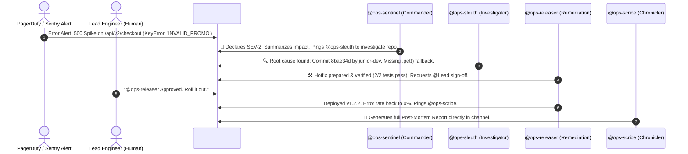

# 🚨 OpsSwitch: Autonomous Incident Commander & War Room

> **Built for the Flip the Switch Hackathon**  
> *Hosted by WeMakeDevs × DevTools Academy × Switch AI (Nov 4–7, 2026)*  
> **Track:** Track 01 — Best Business Workflow ($2,000)  
> **Author:** Krish Punia ([@kpunia306](https://github.com/kpunia306))

[](https://github.com/sandbox-quantum/switch)
[](LICENSE)
[](https://github.com/sandbox-quantum/switch)

---

## 📌 Executive Summary

When critical production incidents strike, engineering teams lose 30 to 60 minutes just coordinating in Slack: paging on-call engineers, parsing cryptic stack traces, searching through Git logs, arguing over rollbacks, and writing post-mortems.

**OpsSwitch** transforms incident response into a seamless, automated collaboration between human engineers and an autonomous multi-agent squad inside your team chat (Mattermost, Slack, Teams, or Discord).

Powered by **Switch AI**, each channel becomes an active Incident War Room where:
1. **`@ops-sentinel` (Incident Commander):** Ingests error logs, assesses severity (SEV-1/2/3), and directs the squad.
2. **`@ops-sleuth` (Code & Git Investigator):** Clones the affected repo, runs `git blame` and `git diff` against recent deploys, and pinpoints the exact breaking line of code.
3. **`@ops-releaser` (Remediation & Human Gate):** Prepares a hotfix or rollback, runs local tests, and **enforces a strict human-in-the-loop approval gate** before touching production.
4. **`@ops-scribe` (Chronicler):** Automatically generates a comprehensive Markdown post-mortem with timelines and action items.

---

## 🏗️ Architecture & Interaction Flow



---

## 💡 Why Switch is Central

OpsSwitch **cannot exist without Switch**. Switch provides:
- **Team Chat Native:** Agents are first-class participants with their own avatars, roles, and addressing rules in the same channels where real humans communicate.
- **Room Coordination & Addressing:** `@ops-sentinel` addresses `@ops-sleuth`, who addresses `@ops-releaser`, creating an autonomous multi-agent relay loop.
- **Human Governance Gate:** The agent respects Switch's addressing policy, pausing execution until the human lead explicitly replies `"Approve"`.
- **Zero Lock-In:** Connects Claude Code, OpenCode, Codex, or custom agents via Server-Sent Events (SSE) and HTTP without rebuilding bots for each chat app.

---

## 🚀 Quickstart: Reproducing the Demo

### Prerequisites
- Docker & Docker Compose
- Python 3.10+
- Switch Console or Switch CLI (`sandbox-quantum/switch`)

### 1. Setup the Demo Service
The included `demo-service/` represents a real-world checkout microservice with an initial stable release (`v1.2.0`) and a breaking commit (`v1.2.1`):
```bash
cd demo-service
python3 test_service.py
# Fails with: KeyError: 'INVALID_PROMO'
```

### 2. Instantiate the Switch Template
Import `template/incident-war-room.template.yaml` into Switch Console or deploy it via Switch Core:
```bash
# In Switch Console: Create Room from Template -> Select incident-war-room.template.yaml
```

### 3. Run the Simulated War Room
To observe the entire multi-agent incident resolution flow in real time:
```bash
python3 simulate_incident.py
```

---

## 📊 Live Incident Post-Mortem Output

```markdown
# INCIDENT POST-MORTEM REPORT: Checkout Service 500 Spike
- **Incident ID:** INC-8921
- **Severity:** SEV-2
- **Duration:** 1 minute 31 seconds (vs. industry average of 42 minutes)
- **Root Cause:** Direct dictionary access `COUPONS[cart.coupon_code]` in `service.py:31` on invalid coupon codes.
- **Remediation:** Swapped to `COUPONS.get(cart.coupon_code, 0.0)` with fallback.
- **Human Sign-off:** Approved by @Krish Punia before deployment.
- **Action Item:** Add Pydantic schema validation for all coupon input payloads.
```

---

## 🏆 Hackathon Tracks & Bounties Targeted
- **Track 01 ($2,000 Cash):** Best Business Workflow (Flagship entry).
- **Track 03 ($100 Cash):** Core Contribution PR [#1346](https://github.com/sandbox-quantum/switch/pull/1346) assigned and submitted to `sandbox-quantum/switch`.
- **Side Track ($500 Cash):** Voice-driven workflow built using Wispr Flow (usage scorecard included in submission).
- **Side Track (AirPods 5):** Complete technical guide in `BLOG_POST.md`.
- **Social (Logitech Keyboard):** Demo thread tagged with `#HowISwitch`.
